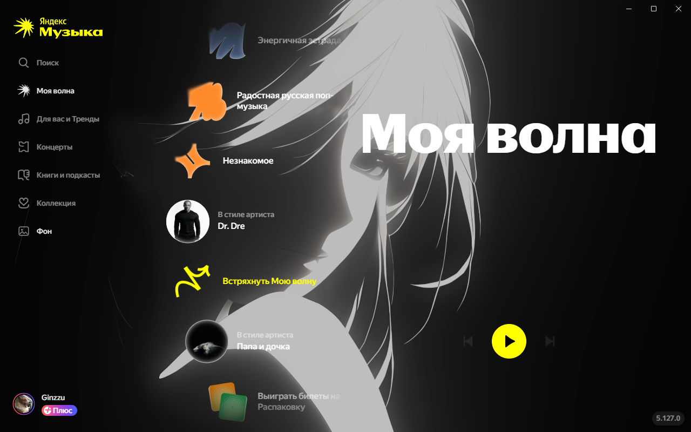
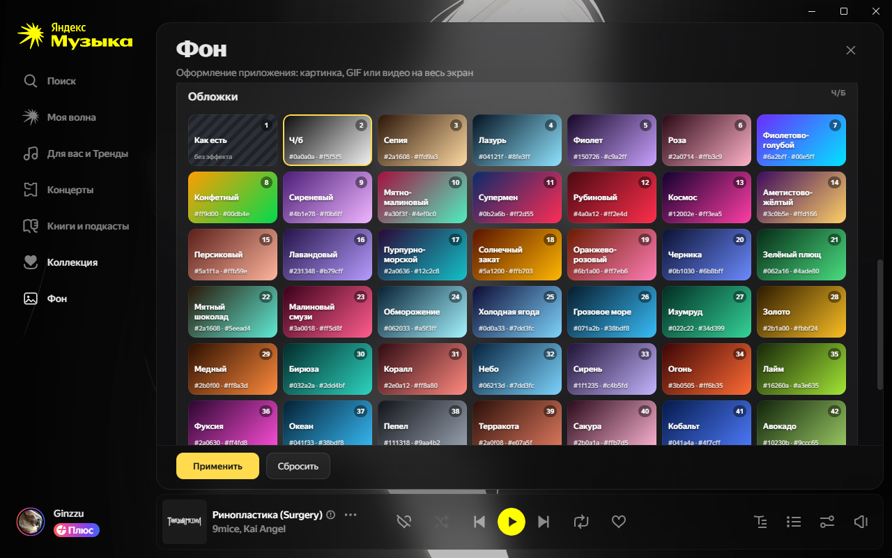
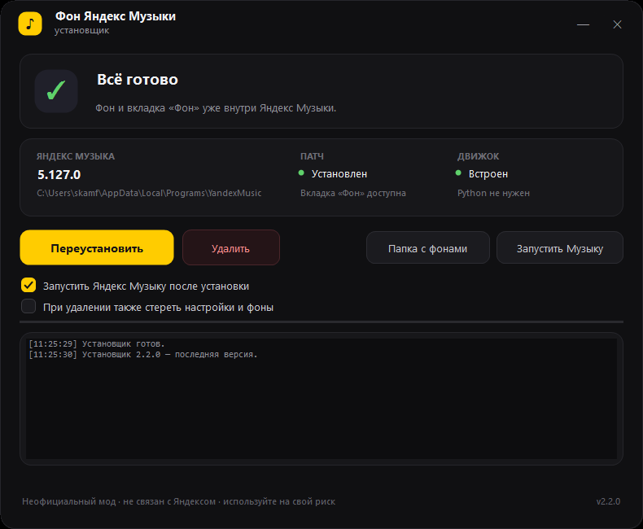

# YaMusicXti — мод для Яндекс Музыки (Windows)

[](CONTRIBUTORS.md)

Мод, который делает Яндекс Музыку своей: красивая картинка или видео на всё окно
вместо анимированного «пузыря», каталог тем для обложек, галерея фонов и живой
статус Discord с текущим треком.

## Скачать

Готовый установщик лежит в [Releases](https://github.com/fanti-scripts/YaMusicXti/releases/latest):
скачай `YaMusicXti-Setup-2.4.0.exe`, запусти и нажми **Установить**.
Python и PowerShell для установки не нужны. Новая версия установщика сама
предложит обновиться, если на GitHub вышла свежая.

## Как это выглядит

**Фон в Яндекс Музыке**



**Каталог тем для обложек**



## Что умеет

- **Фон на всё окно** — без чёрных полос по бокам, включая боковое меню.
- **Своя картинка** — JPG, PNG, WEBP, AVIF, BMP.
- **Живой фон** — GIF, MP4, WEBM, MOV без практического лимита: файл
  114 МБ и больше играет нормально (жёсткий потолок — 2 ГБ).
- **Обои из ссылки или кода** — прямая ссылка на файл, ссылка на страницу
  с видео (og:video / `<video>` / iframe) или готовый HTML-код.
- **Wallpaper Engine** — можно перетащить `.zip` проекта: видео и веб-обои
  ставятся как есть, у сцен (`type: scene`) используется превью — без самого
  Wallpaper Engine сцену не проиграть, и мод честно об этом пишет.
- **Адаптивный режим** — фоном становится обложка играющего трека,
  с плавным переходом при смене песни.
- **Настройка вида** — размытие, яркость, затемнение, виньетка, прозрачность
  и размытие плеера.
- **Каталог тем обложек** — больше 50 градиентных тем: от ч/б и сепии до
  неона и северного сияния. У каждой плитки превью-градиент, название и
  HEX-коды, выбор применяется ко всем обложкам сразу. Наведение лишь слегка
  подсвечивает плитку в выбранном тоне; своя аватарка в меню остаётся цветной.
- **Discord Rich Presence** — текущий трек в статусе Discord: название,
  исполнитель, обложка и живой прогресс. Две кнопки: **«Скачать мод»** на этот
  репозиторий и поиск трека в Яндекс Музыке. Работает из коробки: Application ID
  и логотип уже вшиты, а когда ничего не играет, показывается логотип мода.
  Токены и пароли не нужны.
- **Галерея «Мои фоны»** — все картинки и видео из папки фонов, плюс `.zip`
  и `.html` из отдельной папки архивов. Правый клик по плитке: свойства
  (разрешение, кадры/с, кодек, битрейт), «Открыть архив», «Показать
  в проводнике», «Удалить».
- **Без телеметрии** — по умолчанию всё локально. Сеть используется только
  в одном случае: если вы сами вставили ссылку на обои или страницу
  и нажали «Вставить» — приложение скачает этот файл.

## Вкладка «Фон» внутри приложения

В боковом меню Музыки есть пункт **Фон**. Он открывает страницу настроек прямо
внутри приложения, в стиле Яндекс Музыки:

- перетащить картинку, GIF, видео, `.zip` (Wallpaper Engine) или `.html`;
- вставить прямую ссылку на файл, ссылку на страницу с обоями или HTML-код
  (iframe / `<video>`);
- галерея **«Мои фоны»** — все файлы из папки фонов с превью (кадр видео, картинка,
  `preview.*` из архива); клик по плитке сразу ставит фон, кнопки «Обновить» и
  «Открыть папку» — рядом. Правый клик по плитке открывает свойства файла
  (разрешение, кадры/с, длительность, кодек, битрейт, размер), «Открыть архив»,
  «Показать в проводнике» и «Удалить»;
- масштаб фона: **Умно** (решает по каждому кадру — почти совпадающие пропорции
  заполняют окно с лёгкой обрезкой, сильно другие показывает целиком на размытой
  подложке) и **Заполнить** (всегда на весь экран, как было раньше);
- ползунки затемнения, размытия, яркости, виньетки, затемнения меню,
  прозрачности, размытия и насыщенности плеера;
- готовые пресеты: Стандарт, Мягко, Кино, Стекло;
- адаптивный фон по обложке играющего трека;
- кнопка «Открыть папку с фонами».

Всё применяется на лету, без перезапуска. Пункт «Фон» не пропадает при
переходах между разделами. Фон виден во всех разделах — Коллекция, Поиск,
Концерты, Книги и подкасты, — но контентные области затемнены нейтральным
чёрным, без синевы, чтобы текст и обложки читались. Сама вкладка «Фон» —
стеклянная, с живым фоном.

## Установщик



`YaMusicXti.exe` — самодостаточный установщик. Ни Python, ни PowerShell
для него не нужны: движок и все файлы встроены внутрь. Запускается двойным
кликом (или через `YaMusicXti.cmd`).

В окне видно версию Музыки, состояние патча и движка. Кнопки: **Установить /
Переустановить**, **Удалить**, **Папка с фонами**, **Запустить Музыку**.

Установщик проверяет обновления на GitHub при запуске и умеет обновить сам
себя: скачивает новый exe в `%LOCALAPPDATA%\YaMusicXti\updates`, запускает
его с `--wait-pid` и передаёт работу, после чего старый файл убирается при
следующем старте. Перекачивать установщик вручную не нужно.

Для скриптов и диагностики у exe есть режим командной строки:

```bat
"YaMusicXti.exe" --status
"YaMusicXti.exe" --apply
"YaMusicXti.exe" --restore
"YaMusicXti.exe" --check-update
"YaMusicXti.exe" --update
```

Дополнительно: `--launch` (запустить Музыку после операции), `--appdir <путь>`
(указать папку клиента вручную), `--out <файл>` (журнал в файл), `--help`.

## Быстрый старт

Поставить или обновить патч (Музыка запустится сама):

```bat
"YaMusicXti.exe" --apply --launch
```

Своя картинка: проще всего перетащить её на вкладку **Фон** внутри Музыки.
Можно и вручную — положить файл в `%APPDATA%\YandexMusic\` с именем
`custom-background.jpg` (или `.png`, `.webp`, `.gif`, `.mp4`, …), вписать это
имя в поле `"file"` в `custom-background.json` и перезапустить приложение.

В папке `%APPDATA%\YandexMusic\` лежат только ваши фоны и
`custom-background.json`. Всё, что мод создаёт сам — превью для галереи,
HTML-обои и файлы, распакованные из `.zip`, — хранится отдельно, в
`%LOCALAPPDATA%\YaMusicXti\`. Загруженные картинки и видео сохраняются под
своим именем; если такой файл уже есть, второй экземпляр не создаётся.

Старые скрипты (`apply.ps1`, `set-background.ps1`) остались как запасной
вариант для тех, кто пользуется PowerShell:

```powershell
powershell -ExecutionPolicy Bypass -File .\apply.ps1 -Image "$env:USERPROFILE\Pictures\my-bg.jpg"
powershell -ExecutionPolicy Bypass -File .\set-background.ps1 "$env:USERPROFILE\Pictures\my-bg.gif"
```

## Настройки — `%APPDATA%\YandexMusic\custom-background.json`

```json
{
  "adaptive": true,
  "file": "",
  "web": "",
  "blur": 0,
  "brightness": 1,
  "dim": 0.25,
  "vignette": 0,
  "navbarDim": 0.35,
  "playerTransparency": 0.48,
  "playerBlur": 20,
  "playerSaturate": 1.15,
  "fade": 600,
  "poll": 1500
}
```

По умолчанию включён адаптивный режим: фоном становится обложка играющего
трека. Если хочется только свою картинку, укажи её в `file` и поставь
`"adaptive": false` (это же делает `set-background.ps1`).

| Поле | Что делает | Значения |
|---|---|---|
| `adaptive` | Фон = обложка текущего трека | `true` / `false` |
| `file` | Имя файла фона в `%APPDATA%\YandexMusic\` (или в кэше `%LOCALAPPDATA%\YaMusicXti\media\`); пусто — без своей картинки | `custom-background.jpg`, `wall.mp4`, … |
| `web` | HTML-обои: `index.html` из кэша `%LOCALAPPDATA%\YaMusicXti\web\` или полный `https://`-адрес страницы | `index.html`, `https://…` |
| `fit` | Масштаб фона: «Умно» или «Заполнить» | `smart` / `cover` |
| `webStamp` | Служебная метка сборки HTML-обоев (чтобы iframe перезагрузился) | число |
| `blur` | Размытие картинки | `0`–`40` (px) |
| `brightness` | Яркость | `0.2`–`1.6` |
| `dim` | Затемнение поверх картинки | `0`–`0.9` |
| `vignette` | Виньетка по краям | `0`–`1` |
| `navbarDim` | Затемнение бокового меню | `0`–`0.8` |
| `playerTransparency` | Прозрачность нижнего плеера | `0`–`0.95` |
| `playerBlur` | Размытие фона плеера | `0`–`40` (px) |
| `playerSaturate` | Насыщенность стекла плеера | `0.5`–`2` |
| `coverStyle` | Тема обложек: `off`, `mono`, `sepia`, `azure`, `violet`, `rose`, `gold`, `aurora`, `neon` и ещё 40+ id из каталога | строка, `mono` |
| `discordRpc` | Показывать текущий трек в статусе Discord | `true` / `false`, `true` |
| `discordClientId` | Application ID приложения мода — зашит в мод, менять нельзя | `"1573173806724419695"` |
| `fade` | Плавность смены фона | мс, `600` |
| `poll` | Как часто проверять смену трека (адаптивный режим) | мс, `1500` |

После правки JSON — перезапуск приложения (или `Ctrl+R`).

### Каталог тем обложек

Внизу вкладки «Фон» — блок «Обложки» с каталогом тем. Одна тема на всё
приложение: подборки на главной, альбомы, треки, плейлисты, миксы, подкасты
и аватарки артистов.

- **Больше 50 тем** — «Как есть», ч/б, сепия, лазурь, фиолет, роза, золото,
  неон, северное сияние, космическая пыль и другие градиенты.
- **Превью на плитке** — каждый вариант показан своим градиентом, с номером,
  названием и HEX-кодами обоих цветов.
- **Дуотон** — обложка переводится в ч/б и раскрашивается выбранным
  градиентом: тёмный тон уходит в тени, светлый — в света. Исходный цвет
  картинки не проступает ни в покое, ни на наведении.

Тема применяется сразу и пишется в `custom-background.json`. Наведение лишь
слегка подсвечивает плитку в выбранном тоне. Своя аватарка в левом меню
всегда остаётся цветной.

```json
{ "coverStyle": "aurora" }
```

### Статус в Discord

Внизу вкладки «Фон» — блок **Discord**. Что показывает:

- название трека и исполнителя (на паузе добавляется «· пауза»);
- обложку альбома и его название;
- прогресс воспроизведения — Discord сам ведёт таймер;
- логотип мода, когда ничего не играет;
- две кнопки: **«Скачать мод»** на этот репозиторий и **«Найти трек»**
  в Яндекс Музыке.

Кнопки видит только другой человек, открывший твой профиль: у себя в своём
статусе ты их не увидишь — это ограничение Discord. Проверять лучше со
второго аккаунта или попросить друга.

**Работает из коробки.** В моде уже прописаны Application ID и логотип,
создавать приложение в Discord Developer Portal не нужно. Достаточно держать
Discord запущенным — статус подключится сам.

Application ID жёстко зашит в мод и в панели не настраивается: статус всегда
идёт через приложение мода. Это сделано специально, чтобы подмена чужого
приложения не ломала кнопку со ссылкой на мод.

Ни токены, ни логин Discord моду не передаются: связь идёт по локальному
именованному каналу Discord IPC. Кнопки и обложка видны в профиле в Discord
на компьютере; в веб-версии и на телефоне кнопки могут не отображаться —
это ограничение самого Discord.

```json
{ "discordRpc": true }
```

### Включить адаптивный фон по обложке

```json
{ "adaptive": true }
```

Если трек не играет — показывается обычная картинка из `file`.

### Живые обои (видео/GIF)

Положи ролик рядом и укажи его в конфиге:

```json
{ "file": "custom-background.mp4", "dim": 0.35 }
```

Видео играет без звука, зациклено. Файл отдаётся локальным сервером
потоком (HTTP Range), поэтому размер ограничен только здравым смыслом и
потолком 2 ГБ — 80 МБ больше не предел.

### Обои из ссылки, страницы или HTML-кода

В поле «Ссылка на обои, страница или HTML-код» можно вставить:

- прямую ссылку на `.mp4`, `.webm`, `.gif`, `.jpg`, `.png`, `.webp`;
- ссылку на страницу — мод найдёт `og:video` / `og:image`, тег `<video>`
  или `<iframe>` и скачает/встроит то, что там есть;
- готовый HTML-код с `<video>`, `<source>` или `<iframe>`;
- ссылку на `.zip` проекта Wallpaper Engine.

### Wallpaper Engine

Перетащи `.zip` проекта прямо на вкладку «Фон»:

| Тип проекта | Что будет |
|---|---|
| `video` | Видео из архива станет фоном |
| `web` | HTML-обои из архива откроются через локальный сервер |
| `scene` / `application` | Поставится `preview.gif` или `preview.jpg`, а панель честно скажет, что сцену без Wallpaper Engine не проиграть |

Это ограничение самого Wallpaper Engine: сцена — набор ассетов и шейдеров
для его движка, а не видеофайл. Мод не пытается его эмулировать.

### Тонкая настройка CSS

`%APPDATA%\YandexMusic\custom-background.css` — необязательный файл.
Правила из него применяются последними и переопределяют встроенные.
Внутри есть готовые примеры (прозрачность меню, стекло, и т.п.).

## Откатить всё назад

Через установщик: кнопка **Удалить** (вернёт оригинальные `app.asar` и `.exe`,
уберёт патч и вкладку «Фон»).

Или из консоли:

```bat
"YaMusicXti.exe" --restore
```

Старый вариант: `powershell -ExecutionPolicy Bypass -File .\restore.ps1`.

## После обновления Яндекс Музыки

Обновление заменяет `app.asar` и `.exe`, поэтому фон и вкладка пропадут.
Запусти установщик ещё раз и нажми **Установить** (или `--apply`). Он сам
определит новую версию, сделает свежие бэкапы и пропатчит её. Картинка
и настройки в `%APPDATA%\YandexMusic\` остаются на месте.

## Как это устроено (технически)

- В `.exe` отключается один Electron-фьюз `EnableEmbeddedAsarIntegrityValidation`
  (иначе изменённый `app.asar` не запускается). Оригинал сохраняется рядом
  как `Яндекс Музыка.exe.orig`.
- В `resources\app.asar` в `index.js` добавляется функция, которая на
  `did-finish-load` читает JSON-конфиг и CSS и запускает движок фона в странице.
- Медиа больше не кодируется в `data:`-URL: локальный сервер отдаёт файл
  потоком через `/media?t=<токен>` с поддержкой HTTP Range, поэтому видео
  любого разумного размера не раздувает память renderer'а.
- Загрузка файлов идёт потоком (`POST /upload`, `POST /wallpaper`) без base64;
  лимит 2 ГБ на медиа и 1 ГБ на архив.
- Для настроек из вкладки «Фон» поднимается локальный HTTP-сервер только на
  `127.0.0.1`. Он принимает запросы лишь с origin приложения и с одноразовым
  токеном, который генерируется при запуске и живёт только в памяти процесса
  (на диск не пишется). Скачивание по ссылке разрешено только на публичные
  http(s)-адреса, с проверкой редиректов.
- HTML-обои (из `.zip` или `.html`) раздаются тем же сервером через
  `/web/<токен>/…`; чужие пути и выход за папку кэша запрещены.
- В папке `%APPDATA%\YandexMusic\` лежат только пользовательские фоны и
  `custom-background.json`. Служебные файлы мода — превью галереи, HTML-обои,
  распакованные из `.zip` фоны и временные загрузки — живут в
  `%LOCALAPPDATA%\YaMusicXti\`, поэтому папка с обоями не засоряется.
- Движок создаёт фиксированный слой под интерфейсом, прячет «пузырь» и фото
  артиста, делает области приложения прозрачными и следит за обложкой трека
  (адаптивный режим).
- Хеши целостности asar пересчитываются, версия патча считается от кода —
  повторный запуск установщика сам обновит патч.

После патча `.exe` теряет цифровую подпись Яндекса (Windows это не мешает
запуску, но антивирус может спросить). Всё обратимо кнопкой **Удалить** или
`--restore`.

## Файлы

```
YaMusicXti.exe              — самодостаточный установщик (без Python и PowerShell)
YaMusicXti.cmd              — ярлык запуска установщика в корне
build.cmd                   — пересобрать exe
tools\build.py              — сборка (csc.exe из .NET Framework)
tools\export_payload.py     — встраивание JS-движка в exe
installer\src\              — исходники установщика на C#
apply.ps1                   — старый способ: установить/обновить патч
set-background.ps1          — старый способ: быстро сменить фон
restore.ps1                 — старый способ: вернуть оригинальные файлы
installer\YaMusicXtiInstaller.ps1 — старый WPF-установщик (fallback)
installer\python\           — Python 3.12 для старых скриптов и сборки (в репозиторий не входит)
custom-background.json      — настройки фона (копируется в %APPDATA%\YandexMusic)
custom-background.css       — дополнительные CSS-правила (необязательно)
tools\asar_patch.py         — исходная логика патча app.asar
tools\fuse_flip.py          — исходная логика переключения фьюза
docs\screenshots\           — скриншоты для README
```

## Сборка из исходников

Нужны Windows, .NET Framework 4.x (в нём есть `csc.exe`) и Python 3.12+.

```bat
build.cmd
```

`build.cmd` найдёт Python в `installer\python` или в `PATH`, соберёт
`YaMusicXti.exe` и встроит в него JS-движок, CSS и JSON. В готовом exe
Python не нужен.

## Лицензия

MIT. См. [LICENSE](LICENSE).

## Участники

| Участник | Вклад |
|---|---|
| **fanti-scripts** | Идея, дизайн, тесты на живой установке, релиз. |

## Дисклеймер

Неофициальный проект, не связан с Яндексом. Мод меняет файлы установленного
клиента; используй на свой риск. Все изменения обратимы кнопкой **Удалить**
в установщике.

## Откуда идеи

Функции вдохновлены аддоном **Custom Background** из мода
[YaMusicMod / LLMusic](https://github.com/xokeza/YaMusicMod) (MIT), но здесь
всё реализовано самостоятельно и локально: без сторонних серверов,
телеметрии и подписок. Исходники и релизы — в этом репозитории.
